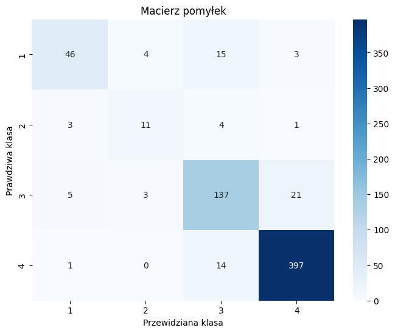
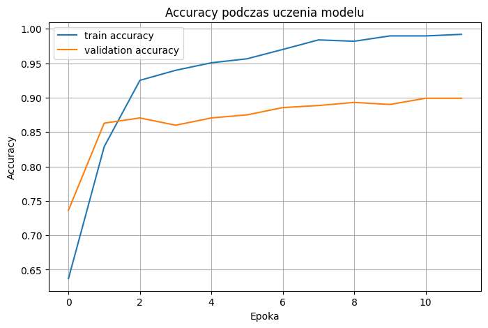
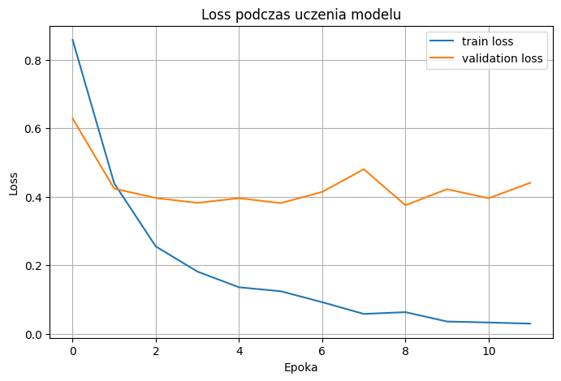

# AiNova – klasyfikacja przetworzenia żywności (NOVA)

Model sieci neuronowej, który na podstawie **listy składników** produktu spożywczego przewiduje jego stopień przetworzenia w skali **NOVA** (1 – nieprzetworzone, 4 – ultraprzetworzone).

> Projekt zespołowy zrealizowany w ramach studiów (Informatyka i Ekonometria, Uniwersytet Gdański).

## Wyniki

| Metryka | Wartość |
|---|---|
| **Accuracy (zbiór testowy)** | **88,9%** |
| Weighted F1 | 0,89 |
| Najlepiej rozpoznawana klasa | NOVA 4 (F1 0,95) |
| Najtrudniejsza klasa | NOVA 2 (tylko 123 przykłady w danych) |



| Accuracy | Loss |
|---|---|
|  |  |

## Dane

- Źródło: [Open Food Facts](https://world.openfoodfacts.org) (licencja ODbL)
- Po oczyszczeniu: **4 429 produktów** w wielu językach (FR, EN, DE, ES…)
- Podział: 3 100 trening / 664 walidacja / 665 test
- Klasy niezbalansowane: NOVA 4 – 2 745, NOVA 3 – 1 108, NOVA 1 – 453, NOVA 2 – 123

## Model

```
tekst składu → TextVectorization (słownik 20k, 80 tokenów)
             → Embedding (64)
             → Bidirectional LSTM (64)
             → Dropout 0.4 → Dense 64 (ReLU) → Dropout 0.3
             → Dense 4 (softmax)
```

- 1,35 mln parametrów, optymalizator Adam, `sparse_categorical_crossentropy`
- Early stopping i zapis najlepszego modelu po `val_loss`
- Analiza błędów: macierz pomyłek, raport klasyfikacji, przegląd źle sklasyfikowanych produktów

## Technologie

**Python** · **TensorFlow / Keras** · **pandas** · **NumPy** · **scikit-learn** · **matplotlib** · **seaborn** · **Jupyter / Google Colab**

## Uruchomienie

```bash
pip install -r requirements.txt
jupyter notebook nova_classifier.ipynb
```

Albo otwórz notebook w Google Colab i wgraj plik `data/openfoodfacts_nn_ready_main.csv`.

## Struktura

```
data/openfoodfacts_nn_ready_main.csv   oczyszczony zbiór danych
nova_classifier.ipynb                  przygotowanie danych, trening, ewaluacja
docs/img/                              wykresy z treningu
```

## Autorzy

Amelia Szczepańska · Patryk Pilarski · Aleksander Fernandes
